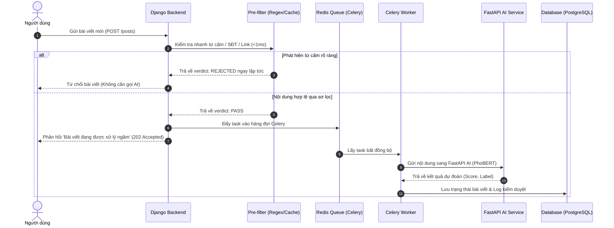

# Tài liệu Kiến trúc Hệ thống Kiểm duyệt (Ngày 12)

## 1. Sơ đồ Kiến trúc Microservices
Hệ thống sử dụng mô hình Docker-orchestrated bao gồm các thành phần chính:
- **Django Backend & Admin**: Xử lý logic nghiệp vụ, quản lý người dùng, phân quyền RBAC, và cung cấp API quản trị.
- **FastAPI AI Service**: Chạy mô hình PhoBERT tối ưu trên CPU/GPU để phân loại nội dung độc hại.
- **Redis Cache & Broker**: Lưu trữ cache từ cấm (SHA-256), giới hạn tần suất (Rate Limiting), và làm message broker cho Celery.
- **Celery Worker**: Xử lý hàng đợi bất đồng bộ (Asynchronous task queue) giúp không làm nghẽn luồng HTTP request của người dùng.

## 2. Luồng Kiểm duyệt Bất đồng bộ (Sequence Diagram)

